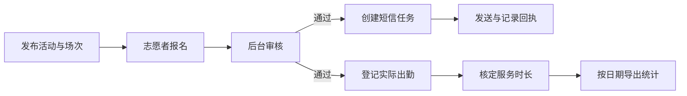
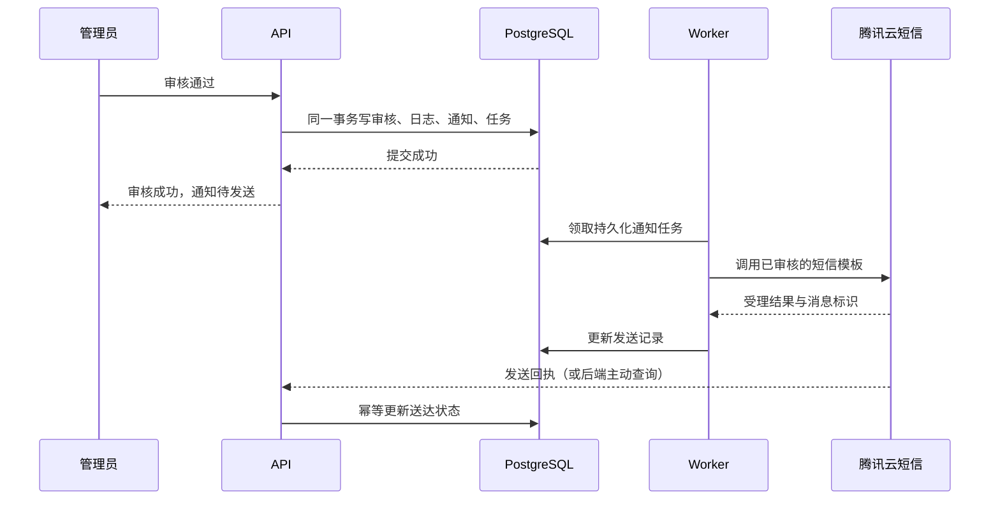

**浙科志愿者招募平台：技术方案草案**

编写日期：2026-10-19。状态：建议方案，尚未实施业务代码。

已确认需求：微信小程序发布活动和招募；Web 后台审核报名；审核通过后自动发送手机短信；按所选时间导出人员参加的活动及服务时长；统计结果用于单位内部统计、留档。后续需求逐步补充，因此首版需要稳定的模块边界、数据模型和扩展接口。

本文暂按“浙科志愿者招募平台”是本次自建平台设计。如果它是已有外部平台，需要先取得其官方接口、授权方式、报名和审核事件能力，再设计对接。没有对方支持的接口，不能承诺自动获得其报名数据或审核结果。

规模假设：一个单位或志愿组织、数名管理人员、数百至数千名志愿者，无支付需求。这是选型依据，不是系统容量上限。

**1. 总体方案与现成组件**

采用 TypeScript 技术栈、pnpm monorepo、模块化单体后端。API 和后台任务共用业务模块与 PostgreSQL，部署为两个进程。功能变化优先调整业务模块与配置。

当前工作区是 React、Ant Design、NestJS、Prisma、PostgreSQL 的学习项目，新平台沿用技术栈和工程经验。建议正式实施时建立独立项目、独立数据库和独立密钥，避免与英语学习业务耦合。

| 部分 | 建议使用 | 直接复用的能力 |
| --- | --- | --- |
| 微信小程序 | Taro + React + TypeScript + NutUI React Taro | 页面路由、表单、列表、日期、上传等小程序组件 |
| Web 管理端 | React + Vite + Ant Design + ProComponents | 管理布局、筛选表格、分页、表单、弹窗和批量操作界面 |
| API | NestJS | 模块组织、依赖注入、鉴权 Guard、参数校验、异常处理 |
| 数据库访问 | Prisma + PostgreSQL | 迁移、类型化查询、事务、关系数据和统计 |
| 后台任务 | pg-boss | 持久化任务、定时执行、重试、并发控制和失败任务管理 |
| 手机短信 | 腾讯云短信 + 官方 Node.js SDK | 签名、通知模板、发送接口、发送结果与回执查询 |
| Excel 导入导出 | ExcelJS | 多工作表、列格式、表头、筛选、导入解析和流式导出 |
| 图片和报表文件 | 腾讯云 COS 私有存储 | 对象存储、受控下载和文件生命周期 |
| 接口文档与类型 | NestJS OpenAPI + openapi-typescript | 在线接口文档、前端接口类型生成 |
| 日志 | Pino / nestjs-pino | 结构化日志、请求追踪和字段脱敏 |
| 部署 | Docker Compose + Caddy | 服务编排、反向代理和 HTTPS |

首版仅需一套 PostgreSQL，pg-boss 与业务数据使用同一个数据库、不同 schema。后续根据实际负载决定是否拆分存储或引入其他基础设施。

版本需要按兼容组合固定，不能全部直接安装 latest。本次查询到的依赖声明：

- Taro 4.x 配合 React 18、NutUI React Taro 3.x 是建议验证的首发组合；NutUI 3.0.20 的 React peer 范围止于 React 18，查询时 latest 标签还指向 4.0.0-beta.9。
- ProComponents 2.8.10 的 Ant Design peer 范围为 4.x/5.x。新后台可采用 React 18 + Ant Design 5 + ProComponents 2，需先验证构建与核心表单、表格；不能直接把它加进当前 Ant Design 6 的项目。
- Web 与小程序分别声明依赖，共享接口契约与纯函数，不强行共享 UI 组件。
- Node.js 24 LTS、受支持的 PostgreSQL 版本满足本次查询到的 pg-boss 运行要求。安装前仍需做一次版本锁定和漏洞检查。

**2. 两端的首版功能**

| 使用方 | 首版功能 |
| --- | --- |
| 志愿者小程序 | 微信登录、维护基础资料和已验证手机号、浏览活动、查看场次和名额、提交及取消报名、查看审核结果、查看个人服务记录和累计时长 |
| Web 管理端 | 活动发布、活动模板与复制、场次管理、报名筛选、单个/批量审核、短信结果查询、出勤登记、批量核定服务时长、人员与活动统计、Excel 导入导出 |
| 系统自动处理 | 审核通过通知、报名截止规则、任务失败记录、报表生成、关键操作审计 |

为减少重复工作，优先提供“复制活动、批量建场次、批量审核、批量确认到场人员、批量赋予默认时长、保存导出条件”。复制活动只复制活动设置，不复制报名、出勤和服务记录。

扫码签到签退、活动前提醒、活动变更通知、候补、服务证明等可以分期增加。首版可由负责人在手机浏览器或 Web 后台批量确认出勤，避免把复杂签到功能作为第一批上线的前置条件。

**3. 业务流程与状态必须分开**



报名审核、通知发送、实际出勤、服务时长分别建模：

- 报名状态：待审核、已通过、已拒绝、已取消。候补作为后续扩展状态。
- 短信状态：待发送、供应商已受理、已送达、发送失败、结果待核查、已作废。
- 出勤状态：未登记、已到场、缺席；以后可增加签退、迟到、早退和补签。
- 服务记录状态：待核定、已核定、已撤销。

通过审核只表示获得参加资格。已到场且核定完成的服务记录才参与正式时长统计。审核失败、取消、缺席、未核定记录不能直接计入。

报名时校验报名截止时间、活动状态、人员资格和重复报名；审核通过时在事务内校验剩余名额，避免多个管理员同时操作导致超额。允许重新申请时沿用报名标识、递增审核版本，并保留历史。

**4. 审核通过后自动发短信**

推荐使用 pg-boss 的数据库事务接入能力：同一事务更新审核结果、写审核日志、写通知记录，并创建通知任务。事务回滚则全部回滚；提交后由 Worker 调用短信服务。



需落实的规则：

1. 只在报名从允许的前置状态变为“已通过”时产生通知事件。重复点击、重复 HTTP 请求不能重复产生同一事件。
2. 每次审核事件有唯一标识；通知以“事件标识 + 通知渠道 + 接收对象”建立唯一约束，重新审核产生新的事件。
3. 发短信前再次检查本次审核是否仍有效、活动是否已取消，失效通知标为作废。
4. 明确的临时错误采用有限次退避重试；模板错误、号码错误等永久错误停止自动重试并展示原因。
5. 请求超时但供应商可能已经受理时，标为结果待核查，先查询回执或人工核查。数据库任务去重不能保证外部短信服务绝对只发送一次。
6. “API 受理成功”和“手机已送达”分开展示。保存供应商消息标识，回执必须关联现有消息，并按供应商支持的认证机制验证请求。
7. 人工补发需有权限、频率限制与操作记录；批量审核按短信接口配额分批发送。
8. 审核结果可在小程序查询；短信故障不撤销已经提交的审核结果。

示例通知正文：

> 【已获授权的单位签名】您报名的“{活动名称}”已审核通过，请于{时间}到{地点}集合，详情请查看小程序。

实际使用必须按供应商审核通过的模板填参，不能把任意富文本作为短信正文。长活动名和地点需控制长度，短信费用按实际计费条数计算。

报名时取得接收本次报名结果通知所需的手机号和告知同意。优先使用小程序可用的手机号授权能力，具体资格、权限及费用以微信后台为准；不可用时提供手动填写并短信验证的方式，验证码发送加频率限制。

腾讯云官方入门文档明确要求短信资质、签名和模板审核，并提示新签名运营商报备一般观察为 7—10 个工作日，实际可能更长。若使用学校或单位名称，应由对应主体提供资质或授权。因此短信资质准备应与开发同时进行，上线时间不能仅按编码时间计算。

**5. 数据模型先覆盖稳定关系**

| 主要数据 | 作用与重要约束 |
| --- | --- |
| Organization | 单位/组织；首版可只有一条，用于管理范围与数据归属 |
| User / WechatIdentity | 系统身份和微信身份；微信身份按 appId + openId 唯一 |
| VolunteerProfile | 姓名、学号/工号、部门/班级、联系方式；单位内人员编号作为稳定识别依据之一 |
| AdminMembership / Role | 管理员、角色和组织权限范围 |
| Activity | 活动介绍、负责人、发布状态、报名规则 |
| ActivitySession | 某天或某班次的起止时间、地点、名额、报名截止时间和时长规则 |
| Application | 人员对某场次的报名、资料快照、审核状态与版本；人员 + 场次唯一 |
| ApplicationReview | 审核事件、审批人、原因、前后状态和审核版本 |
| Attendance | 原始出勤事实、登记方式、登记人和修正记录 |
| ServiceRecord | 按人员、场次、服务日期核定的分钟数及有效状态 |
| ServiceRecordRevision | 时长核定、修改、撤销的前后值与理由 |
| Notification | 通知事件、接收人快照、模板及参数、幂等键、当前发送状态 |
| NotificationAttempt | 每次发送或核查的结果、供应商标识和失败原因 |
| ExportJob | 筛选条件、操作者、生成状态、统计口径版本和私有文件位置 |
| AuditLog | 发布、审核、时长调整、人工补发、导出等关键操作记录 |

从一开始就拆分“活动”和“场次”。例如一个长期的校园引导志愿活动，可以有每天上午、下午等多个场次，报名、名额和出勤都归属具体场次。

手机号不作为人员主键，微信昵称也不能作为统计身份。资料变更不改变既有服务记录的归属；需要历史留档的部门/班级等字段保留记录时的快照。

核心字段使用结构化列及索引，报名补充项可使用带版本的 JSONB 表单配置。表单快照与报名一起保存；无需为了未来未知需求建立通用低代码表单或流程平台。

**6. 一键导出的统计口径**

推荐首版输入：日期范围、部门/班级、人员、活动；默认只统计“已核定且当前有效”的服务记录。时间按 Asia/Shanghai 解释；日期范围在接口中转换为开始日零点至结束日次日零点的左闭右开区间。

按实际服务日期筛选，不按报名提交日期、审核日期或导出日期筛选。跨天场次在核定时拆分为各服务日期的记录，分配后的分钟数之和等于核定总分钟数，避免月末跨天活动被整笔算入某一个月。

时长数据库统一保存整数分钟，展示与导出时转换为小时。固定时长、按出勤计算、人工核定三种规则通过配置选择；批量默认赋值后可逐人调整并注明理由。活动规则调整不覆盖已核定历史记录。

一个 Excel 默认包含三张表：

| 工作表 | 建议字段 |
| --- | --- |
| 人员活动明细 | 姓名、学号/工号、部门/班级、活动名称、场次、服务日期、出勤情况、核定分钟、核定小时 |
| 人员汇总 | 姓名、学号/工号、部门/班级、参加活动数、参加场次数、总分钟、总小时 |
| 活动汇总 | 活动名称、场次、服务日期、实际参加人数、核定总时长 |

活动数按不同活动去重，场次数按不同场次去重，不能把明细行数直接当活动数。汇总先累计分钟，再转换显示，避免逐条四舍五入导致总数不一致。

所有导出均由后端重新校验数据权限并查询全部符合条件的记录，不依赖 Web 当前页数据。默认模板不导出手机号；确有需要时由具有相应权限的人选择。

导出使用后台任务生成文件，Web 展示进度并自动提供下载。生成时在一致性读取中固定结果数据，同时保存筛选条件、生成时间、统计口径版本与文件；后续补录或修正需重新生成新文件。私有文件通过鉴权或短时签名地址下载，并配置保留期限。

导入历史人员与服务记录时，先预览、校验编号与重复数据，再确认写入；保存导入批次及错误清单，避免重复上传造成重复累计。

**7. 工程目录与扩展边界**

以下是建议新项目结构，不是本次已经创建的应用：

```text
volunteer-platform/
  apps/
    miniapp/                  # Taro 微信小程序
    admin/                    # React Web 后台
    api/                      # NestJS HTTP 入口
    worker/                   # 短信、报表、提醒任务入口
  packages/
    backend/                  # 两个后端入口共用的业务模块
      auth/
      organization/
      volunteer/
      activity/
      application/
      attendance/
      service-record/
      notification/
      reporting/
      audit/
    contracts/                # OpenAPI 生成类型、共享枚举
    database/                 # Prisma schema、迁移、数据库接入
    config/                   # 配置校验与基础工具
  deploy/                     # Compose、Caddy、备份与恢复说明
  docs/                       # 接口、业务规则、部署手册
```

通知模块通过 SmsProvider 接口接入腾讯云，开发环境使用 Mock 实现；任务只引用内部通知标识，业务模块不依赖供应商字段。以后接入阿里云短信、增加微信订阅消息时扩展适配器，微信订阅消息的用户授权单独处理。

导出模块通过报表模板配置定义列名、顺序和格式；统计查询和展示模板分开。报名规则、通知模板、时长规则保留配置入口，新增业务不需要修改公共鉴权或数据库接入层。

权限由后端执行。首版角色可为：系统管理员、活动负责人、统计人员、志愿者。活动负责人限定在授权活动范围内；统计人员按授权范围查看和导出；志愿者只能访问自己的报名和服务记录。

微信登录由后端用 code 换取身份，再签发本系统会话；AppSecret 和短信密钥只保存在后端。管理员密码使用 Argon2id 等适当的密码哈希方案；当前学习项目中的 MD5 与演示令牌时长不能直接用于正式平台。

**8. 部署、成本与运行保障**

起步可使用一台国内 2 核 4 GB 云主机部署 Caddy、API、Worker 和 PostgreSQL，文件放 COS。小程序使用该 API 的 HTTPS 域名，Web 后台静态文件由 Caddy 提供。正式规模与可用性要求提升后，可迁移到托管数据库并扩大资源。

费用由云主机/数据库、域名、对象存储、短信、小程序主体相关认证等组成。预算粗估可先预留每月数十至数百元基础资源费，外加短信；这不是实时云产品报价，正式采购按续费价、流量、备份和短信计费规则计算。

短信成本计算为“实际计费条数 × 套餐单价”，验证码、补发和长短信拆分均可能增加条数。先申请通知模板及主体授权，再按每月预计通过人数估算短信量。

小程序备案、主体类目、服务器域名配置与国内域名备案需按实际主体准备。使用单位/学校身份的小程序、短信签名和域名归属应协调一致，办理进度单独跟踪。

首版运行保障包括数据库每日备份至不同存储位置、保留多个恢复点、定期验证恢复；日志中手机号脱敏；监控 API 健康、Worker 心跳、失败通知和导出失败；异常在后台明确可见。

**9. 实施顺序与验收**

| 阶段 | 交付物 | 完成标准 |
| --- | --- | --- |
| 1：基础框架 | monorepo、数据库迁移、登录与权限、接口文档、Mock 短信、后台任务、部署配置 | 两端可调用同一后端；未授权请求被拒绝；任务重启后仍存在 |
| 2：招募闭环 | 活动与场次、小程序报名、后台审核、短信通知与失败记录 | 批量审核不超名额；通过后产生通知；重复请求不重复触发同一通知事件 |
| 3：统计闭环 | 出勤登记、批量核定、修正留痕、三张 Excel 表、历史数据导入 | 缺席不计时；跨月口径明确；汇总分钟与明细一致；导出包含全部筛选结果 |
| 4：试用完善 | 活动模板、批量操作优化、按反馈增加扫码与提醒 | 用一次真实活动完整演练，能替代原来的登记和统计步骤 |

按一名熟悉该栈的开发者、需求边界如上估算，核心可用版约 3—5 个开发周；兼职、学习和需求新增会延长，微信与短信等外部审核时间另计。首周就应启动主体及短信准备。

关键验证覆盖：重复报名；并发审核与名额；重复审批请求；审核撤回后的通知作废；短信明确失败与超时未知两种分支；任务进程重启；月底跨天和未核定时长；时长修正后重新出表；导出权限；个人数据访问隔离。

首个完整演练建议使用“同一活动两个场次、多人报名、部分通过、部分缺席、一人提前离场”的样例，并对照手工统计结果。真实短信联调仅向明确同意接收测试的号码进行。

**10. 参考来源与待确认事项**

本次已查询 npm 官方注册表中的包元数据与依赖声明，以及腾讯云官方短信入门文档。下面的项目链接用于进一步实现与版本验证，不表示已对其全部功能完成集成测试。

- [Taro 项目](https://github.com/NervJS/taro)；[本次查询的 Taro 元数据](https://registry.npmjs.org/@tarojs%2ftaro/latest)。
- [NutUI React 项目](https://github.com/jdf2e/nutui-react)；[本次查询的 NutUI React Taro 元数据](https://registry.npmjs.org/@nutui%2fnutui-react-taro)。
- [ProComponents 项目](https://github.com/ant-design/pro-components)；[本次查询的 ProComponents 元数据](https://registry.npmjs.org/@ant-design%2fpro-components/latest)。
- [pg-boss 项目与文档](https://pgboss.io/)；[本次查询的包说明，含现有事务与 Prisma 接入能力](https://registry.npmjs.org/pg-boss)。
- [ExcelJS 项目](https://github.com/exceljs/exceljs)；[本次查询的 ExcelJS 元数据](https://registry.npmjs.org/exceljs/latest)。
- [腾讯云国内短信快速入门](https://cloud.tencent.com/document/product/382/37745)。

待确认、但不影响核心方案推进的内容：平台是自建名称还是已有外部系统；可使用的单位/学校主体与短信签名授权；报名资料中是否需要学号/工号与部门/班级；实际活动规模及是否要求扫码签到；最终留档报表的固定字段。本文不假定有官方志愿服务平台同步能力，已确认用途为内部统计、留档。
